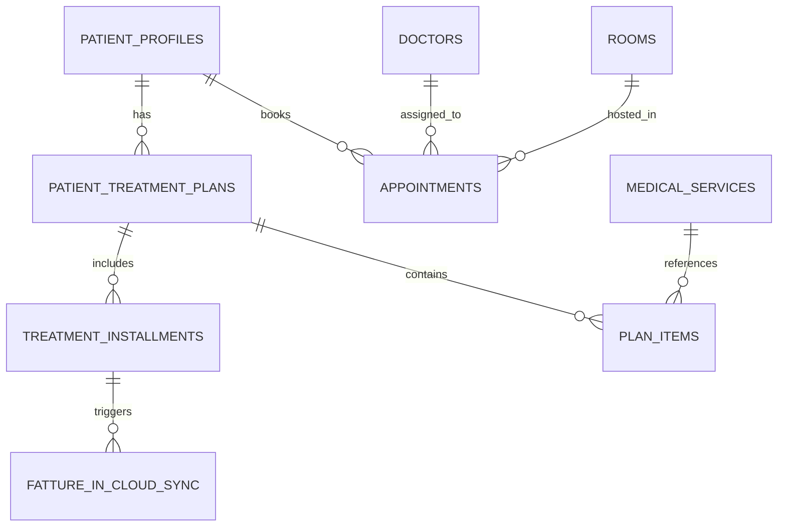

# 🏥 Architettura Database Relazionale & Modulo CRM Receptionist (Cocoora)

## 📌 Stato del Database: PREDISPOSTO (Nessun deploy cloud remoto ancora effettuato)

> [!NOTE]
> Il database **non è ancora stato istanziato o collegato su Supabase remoto**.
> È stato **interamente progettato e predisposto a livello di codice locale** nel file di migrazione SQL:
> [`supabase/migrations/20261016_cocoora_crm_schema.sql`](file:///c:/Users/mario/Progetti%20Antigravity/Cocoora/supabase/migrations/20261016_cocoora_crm_schema.sql)
> Quando verrà decisa l'attivazione del progetto Supabase per Cocoora, basterà lanciare questa migrazione per avere l'intero schema pronto in 2 secondi.

---

## 🗄️ Entità e Modello Relazionale

### 1. Multi-Anagrafica Pazienti (`patient_profiles`)
- Supporta fino a 2-3 pazienti (es. componenti dello stesso nucleo familiare) collegati alla **stessa email** di recapito, ma con `patient_id` (UUID), codice fiscale e cartella clinica rigorosamente distinti.

### 2. Piani Terapeutici Pluriennali (`patient_treatment_plans`)
- Gestione di preventivi e percorsi da €900 a €3.000 (es. Allineatori trasparenti, cicli di Medicina Estetica, percorsi Club avanzati).
- Campi: `total_amount`, `paid_amount`, `balance_remaining`, `status` (`bozza`, `attivo`, `sospeso`, `completato`).
- Calcolo automatico e barra di avanzamento dello stato del saldo.

### 3. Acconti e Rate (`treatment_installments`)
- Registrazione dei singoli versamenti (contanti, POS, Stripe, Klarna, PayPal, bonifico).
- Ogni acconto aggiorna in tempo reale il `paid_amount` e il `balance_remaining` del piano terapeutico genitore.

### 4. Integrazione Flessibile Fatture in Cloud API (`fatture_in_cloud_sync`)
- Coda di sincronizzazione per supportare la doppia modalità di fatturazione:
  1. **Fattura ad ogni singolo acconto**: per pagamenti standard o quietanze progressive.
  2. **Fattura a saldo / fine percorso**: richiesta spesso per i rimborsi assicurativi dei fondi sanitari (FASI, FASDAC, Metasalute) con documentazione fotografica e clinica allegata.

### 5. Calendario e Conflitti Slot (`appointments`, `rooms`, `doctors`)
- Gestione delle 3 sale cliniche reali: **Studio 1, Studio 2, Studio 3**.
- Vincolo di esclusione `GiST` per evitare double-booking sulla combinazione: `room_id + doctor_id + time_range`.
