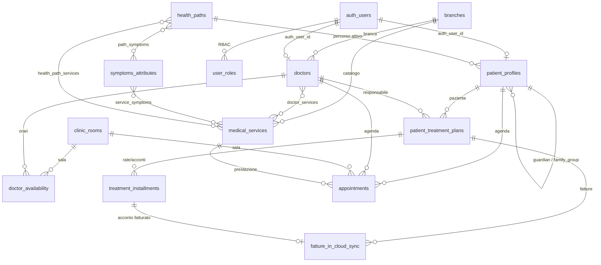
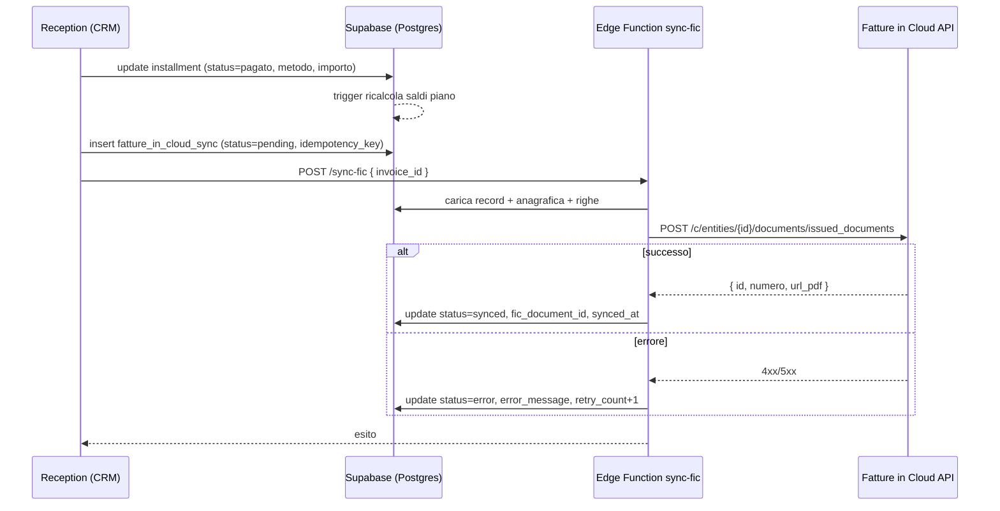

# Cocoora — Architettura Backend CRM & Sync Fatture in Cloud

> Documento tecnico di riferimento per il **Gestionale CRM Receptionist** di Cocoora Studio
> Medico Polispecialistico (Napoli). Descrive lo schema relazionale Supabase, le policy RLS,
> i flussi operativi della reception e la sincronizzazione fiscale con **Fatture in Cloud**.
>
> Migrazione di riferimento: `supabase/migrations/20261016_cocoora_crm_schema.sql`

## 📌 Stato del database: PREDISPOSTO (nessun deploy cloud remoto effettuato)

> [!NOTE]
> Il database **non è ancora stato istanziato o collegato su Supabase remoto**.
> È stato interamente progettato e predisposto a livello di codice locale nel file di migrazione
> [`supabase/migrations/20261016_cocoora_crm_schema.sql`](../supabase/migrations/20261016_cocoora_crm_schema.sql).
> Quando verrà decisa l'attivazione del progetto Supabase per Cocoora basterà lanciare questa
> migrazione per avere l'intero schema pronto.

---

## 1. Contesto e obiettivi

Il CRM nasce per dare alla reception di Cocoora un unico punto di verità su:

| Dominio | Bisogno operativo |
|---|---|
| **Anagrafica** | Pazienti con **multi-anagrafica** (2–3 pazienti che condividono la stessa email, es. nuclei familiari) ma `patient_id` sempre univoco. |
| **Catalogo clinico** | Medici, branche, prestazioni, orari e sale (Studio 1 / 2 / 3). |
| **Percorsi Club** | I **9 Percorsi Salute Cocoora Club** con i servizi inclusi e la differenziazione uomo/donna. |
| **Matching** | Matrice sintomi/inestetismi → prestazioni e percorsi per il filtro **"Trova il tuo percorso"**. |
| **Piani terapeutici** | Piani pluriennali (**€900 – €3.000**) con totale, acconti pagati, saldo residuo e stato. |
| **Incassi** | Rate e acconti singoli con metodo di pagamento (contanti, POS, Stripe, Klarna, PayPal…). |
| **Fisco** | Emissione fattura **ad ogni acconto** oppure **a saldo/fine percorso** per il **rimborso assicurativo**, tracciata su Fatture in Cloud. |
| **Compliance** | Audit trail GDPR e RLS granulare per Receptionist, Medici, Pazienti e Admin Creativia. |

### Attori

| Ruolo (`app_role`) | Chi | Perimetro |
|---|---|---|
| `admin_creativia` | Antigravity / Creativia | Accesso totale (configurazione, RBAC, audit). |
| `receptionist` | Reception Cocoora | Anagrafiche, agenda, piani, rate/acconti, invio fatture. |
| `doctor` | Medici specialisti | Solo i propri pazienti, piani e appuntamenti; modifica dati clinici. |
| `accountant` | Amministrazione | Lettura anagrafiche/piani/rate, gestione stato fatture. |
| `patient` | Paziente | Sola lettura dei propri dati, piani, rate, fatture; richiesta appuntamenti. |

---

## 2. Architettura logica

```text
                         ┌────────────────────────────────────────────┐
                         │              SUPABASE (PostgreSQL)          │
                         │                                            │
   App Pazienti  ───────▶│  Auth (auth.users) ──▶ user_roles (RBAC)    │
   (PWA / portale)       │        │                                   │
                         │        ├─ patient_profiles  (multi-anagrafica)
   Reception CRM ───────▶│        ├─ doctors / branches / clinic_rooms
   (gestionale)          │        ├─ medical_services / symptoms_attributes
                         │        ├─ health_paths (9 Percorsi Club)   │
   Portale pubblico ────▶│        ├─ patient_treatment_plans          │
   (Trova il percorso)   │        ├─ treatment_installments           │
                         │        └─ fatture_in_cloud_sync ───┐       │
                         └────────────────────────────────────┼───────┘
                                                              │ Edge Function
                                                              ▼
                                       ┌────────────────────────────────┐
                                       │  Fatture in Cloud API (REST)   │
                                       │  Fattura SDI / nota credito    │
                                       └────────────────────────────────┘
```

- **Supabase** è il sistema di record: schema relazionale, RLS, trigger di calcolo saldi e audit.
- **Fatture in Cloud** è il sistema fiscale: riceve l'ordine di emissione e restituisce
  `document_id`, numero e URL del PDF, che vengono salvati in `fatture_in_cloud_sync`.
- **Stripe / Klarna / PayPal / POS** restano sistemi di incasso: il CRM registra l'esito in
  `treatment_installments` (metodo + riferimento esterno) e, se previsto, innesca la fattura.

### Diagramma ER (concettuale)



---

## 3. Modello dati

### 3.1 Anagrafica studio

| Tabella | Ruolo | Colonne chiave |
|---|---|---|
| `branches` | Branche cliniche | `slug`, `name` |
| `clinic_rooms` | Sale (Studio 1/2/3) | `slug`, `name`, `floor` |
| `doctors` | Anagrafica medici | `slug`, `full_name`, `branch_id`, `specialty_slug`, `tariffa_visita`, `auth_user_id` |
| `doctor_availability` | Orari ricorrenti | `doctor_id`, `room_id`, `weekday` (1=Lun), `start_time`, `end_time`, `slot_minutes` |
| `medical_services` | Catalogo prestazioni | `slug`, `code`, `category`, `branch_id`, `base_price`, `is_club_included`, `is_precision` |
| `doctor_services` | Medico ↔ prestazione | `doctor_id`, `service_id`, `custom_price` |

### 3.2 Motore "Trova il tuo percorso"

| Tabella | Ruolo |
|---|---|
| `symptoms_attributes` | Sintomi e inestetismi (`slug`, `label`, `category`, `area`). |
| `service_symptoms` | Matrice **prestazione ↔ sintomo** con `weight` (peso di rilevanza). |
| `path_symptoms` | Matrice **percorso ↔ sintomo** con `weight`. |
| `health_paths` | I **9 Percorsi Salute Cocoora Club** (vedi §3.3). |
| `health_path_services` | Servizi inclusi, con `gender_scope` (`uomo`/`donna`/`non_specificato`) e `included_quantity`. |

**Funzioni di matching** (SECURITY INVOKER, applicano la RLS del catalogo):

- `match_paths_by_symptoms(text[])` → percorsi ordinati per punteggio.
- `match_services_by_symptoms(text[])` → prestazioni ordinate per punteggio.

### 3.3 I 9 Percorsi Salute Cocoora Club

| # | Slug | Nome | Livello | Prezzo/anno |
|---|---|---|---|---|
| 1 | `discover` | Discover | free | €0 |
| 2 | `access` | Access | basic | €99 |
| 3 | `care` | Care | plus | €349 |
| 4 | `experience` | Experience | premium | €649 |
| 5 | `signature` | Signature | experience_plus | €890 |
| 6 | `signature-longevity` | Signature Longevity | longevity | €1.190 |
| 7 | `family-basic` | Family Care Basic | family_addon | €149 |
| 8 | `family-elite` | Family Care Elite | family_addon | €199 |
| 9 | `family-senior` | Family Care Senior | family_addon | €249 |

> Gli add-on Family richiedono un percorso adulto (`requires_adult_path = true`) e il
> `discount_percent` replica lo sconto del percorso collegato.

### 3.4 Pazienti e multi-anagrafica

`patient_profiles` è progettata per il caso reale di **più anagrafiche sotto la stessa email**:

- `patient_code` → **identificativo univoco** (`COC-2026-00001`), generato da trigger.
- `email` → **non univoca**: indicizzata (`ix_patient_profiles_email`) ma condivisibile.
- `family_group_id` → raggruppa i profili di uno stesso nucleo (es. genitore + figli).
- `is_account_holder` → indica il titolare dell'account che gestisce il gruppo.
- `guardian_patient_id` + `relationship` → collega un minore al genitore/tutore.
- `fiscal_code` → univoco **solo se presente** (indice parziale `ux_patient_profiles_fiscal_code`).

```sql
-- Due anagrafiche, stessa email, due patient_code distinti
insert into public.patient_profiles (first_name, last_name, email, family_group_id, is_account_holder)
values ('Giulia', 'Rossi', 'famiglia.rossi@email.it', gen_random_uuid(), true);

insert into public.patient_profiles (first_name, last_name, email, family_group_id, guardian_patient_id, relationship)
select 'Marco', 'Rossi', 'famiglia.rossi@email.it', family_group_id, id, 'genitore'
from public.patient_profiles where first_name = 'Giulia' and last_name = 'Rossi';
```

### 3.5 Piani terapeutici, rate e saldi

`patient_treatment_plans` mantiene i totali economici del piano:

| Colonna | Significato |
|---|---|
| `total_amount` | Totale a listino del piano (tipico **€900 – €3.000**). |
| `discount_amount` | Sconto applicato. |
| `net_total` | Netto concordato (`total_amount − discount_amount`), calcolato. |
| `paid_total` | Totale acconti/rate **pagati**, calcolato dai trigger. |
| `balance_due` | **Saldo residuo** (`net_total − paid_total`), calcolato. |
| `status` | Ciclo di vita: `bozza` → `attivo` → `completato` / `sospeso` / `annullato`. |
| `payment_status` | `non_pagato` / `parzialmente_pagato` / `saldato` / `rimborsato`. |

`treatment_installments` registra ogni movimento:

- `installment_type`: `acconto` · `rata` · `saldo` · `conguaglio`
- `payment_method`: `contanti` · `pos` · `stripe` · `klarna` · `paypal` · `bonifico` · `assegno` · `altro`
- `status`: `previsto` · `pagato` · `scaduto` · `annullato` · `rimborsato`
- `external_payment_id`: riferimento Stripe/Klarna/POS.

> **Calcolo automatico**: i trigger `trg_installments_sync` e `trg_plan_recalc` richiamano
> `recalc_plan_financials(plan_id)`, che ricalcola `paid_total`, `balance_due`, `payment_status`
> e — a saldo — porta il piano a `completato`. La reception non aggiorna mai i saldi a mano.

### 3.6 Sincronizzazione Fatture in Cloud

`fatture_in_cloud_sync` traccia ogni emissione:

| Colonna | Significato |
|---|---|
| `idempotency_key` | Chiave univoca che impedisce doppie emissioni (es. `acconto:{installment_id}`). |
| `document_type` | `fattura` · `nota_credito` · `ricevuta`. |
| `issue_reason` | `acconto` · `saldo` · `fine_percorso` · `rimborso_assicurativo`. |
| `amount` / `vat_amount` / `currency` | Importi del documento. |
| `fic_*` | ID, numero, URL del documento restituiti dall'API. |
| `status` | `pending` · `queued` · `synced` · `error` · `void` · `skipped`. |
| `request_payload` / `response_payload` | Log completo per audit e retry. |
| `retry_count` / `last_attempt_at` | Gestione errori e retry. |

> La fatturazione copre le due modalità richieste da Cocoora:
> 1. **Fattura ad ogni singolo acconto** (quietanze progressive);
> 2. **Fattura a saldo / fine percorso** per i **rimborsi assicurativi** dei fondi sanitari.

---

## 4. Sicurezza: RLS e matrice dei permessi

Tutte le tabelle hanno **Row Level Security attiva**. Le policy si appoggiano a funzioni
`SECURITY DEFINER` che leggono `user_roles` bypassando la RLS (evitando ricorsione):

| Funzione | Ritorna |
|---|---|
| `current_app_role()` | Ruolo principale dell'utente. |
| `has_role(app_role...)` | `true` se l'utente ha uno dei ruoli indicati. |
| `is_admin_creativia()` / `is_staff()` / `is_billing()` | Scorciatoie di ruolo. |
| `current_doctor_id()` / `current_patient_id()` | Collegamento medico/paziente dell'utente. |
| `doctor_can_access_patient(uuid)` / `doctor_can_access_plan(uuid)` | Scoping del medico. |

### Matrice permessi

| Tabella | Admin | Receptionist | Medico | Accountant | Paziente | Anon |
|---|---|---|---|---|---|---|
| Catalogo (`branches`, `medical_services`, `health_paths`, `symptoms_attributes`, …) | R/W | R/W | R | R | R | **R** |
| `doctors` | R/W | R/W | R + update proprio | R | R | R |
| `doctor_availability` | R/W | R/W | R/W propri orari | R | R | R |
| `user_roles` | R/W | — | R proprio | — | R proprio | — |
| `patient_profiles` | R/W | R/W | R propri pazienti | R | R/W proprio | — |
| `patient_treatment_plans` | R/W | R/W | R/W propri piani | R | R propri | — |
| `treatment_installments` | R/W | R/W | R propri piani | R/W | R propri | — |
| `fatture_in_cloud_sync` | R/W | R/I/U | — | R/W | R proprie | — |
| `appointments` | R/W | R/W | R/W propri | — | R + insert richiesta | — |
| `crm_audit_log` | R | — | — | — | — | — |

**Note di sicurezza**

- L'audit trail è scritto da un trigger `SECURITY DEFINER`: nessun ruolo applicativo può
  inserire/modificare direttamente `crm_audit_log`.
- I pazienti possono **richiedere** appuntamenti (`status = 'richiesto'`) ma non modificarne lo stato.
- Le operazioni fiscali avvengono tramite **service role** (Edge Function), mai con la chiave anon.
- La chiave `service_role` **non deve mai** essere esposta al client.

---

## 5. API Reception — esempi di chiamata

Client consigliato: `@supabase/supabase-js`. La reception autentica l'utente staff; la RLS
garantisce che veda solo ciò che gli compete.

### 5.1 Nuova anagrafica paziente

```ts
import { createClient } from "@supabase/supabase-js";

const supabase = createClient(SUPABASE_URL, SUPABASE_ANON_KEY);
await supabase.auth.signInWithPassword({ email: receptionEmail, password });

// patient_code è generato automaticamente dal trigger
const { data: patient, error } = await supabase
  .from("patient_profiles")
  .insert({
    first_name: "Giulia",
    last_name: "Rossi",
    email: "giulia.rossi@email.it",
    phone: "+39 333 0000000",
    fiscal_code: "RSSGLI90A01F839X",
    birth_date: "1990-01-01",
    gender: "donna",
    health_path_id: accessPathId,
    gdpr_consent_at: new Date().toISOString(),
  })
  .select("id, patient_code")
  .single();
```

### 5.2 Creazione piano terapeutico + rate

```ts
const { data: plan } = await supabase
  .from("patient_treatment_plans")
  .insert({
    patient_id: patient.id,
    doctor_id: doctorId,
    title: "Percorso ortodontico Invisalign — 18 mesi",
    total_amount: 2400,
    discount_amount: 200,
    duration_years: 2,
    start_date: "2026-10-16",
    status: "attivo",
  })
  .select("id, plan_code")
  .single();

// Acconto iniziale + rate mensili (i saldi del piano si aggiornano da soli)
await supabase.from("treatment_installments").insert([
  { plan_id: plan.id, installment_number: 1, installment_type: "acconto", amount: 600, due_date: "2026-10-16", status: "pagato", payment_method: "pos", paid_at: new Date().toISOString() },
  { plan_id: plan.id, installment_number: 2, installment_type: "rata",    amount: 300, due_date: "2026-11-16" },
  { plan_id: plan.id, installment_number: 3, installment_type: "rata",    amount: 300, due_date: "2026-12-16" },
  { plan_id: plan.id, installment_number: 4, installment_type: "saldo",   amount: 1000, due_date: "2027-06-16" },
]);
```

### 5.3 Registrazione di un acconto (con metodo di pagamento)

```ts
await supabase
  .from("treatment_installments")
  .update({
    status: "pagato",
    payment_method: "klarna",       // contanti | pos | stripe | klarna | paypal | bonifico | assegno
    external_payment_id: "KLARNA-ORD-88912",
    paid_at: new Date().toISOString(),
    receipt_number: "REC-2026-0451",
  })
  .eq("id", installmentId);
// → trigger ricalcola paid_total / balance_due / payment_status del piano
```

### 5.4 Rate in scadenza (cruscotto incassi)

```ts
const { data: due } = await supabase
  .from("v_installments_due")
  .select("plan_code, patient_name, installment_type, amount, due_date, status, days_overdue")
  .order("due_date", { ascending: true });
```

### 5.5 Prenotazione appuntamento (con conflict-detection)

```ts
const startsAt = "2026-10-20T09:30:00+02:00";
const endsAt   = "2026-10-20T10:00:00+02:00";

// 1) Verifica disponibilità
const { data: free } = await supabase.rpc("is_slot_available", {
  p_doctor_id: doctorId, p_starts_at: startsAt, p_ends_at: endsAt,
});

// 2) Inserimento (l'exclusion constraint impedisce doppi booking a livello DB)
if (free) {
  await supabase.from("appointments").insert({
    patient_id: patient.id,
    doctor_id: doctorId,
    room_id: roomId,
    service_id: serviceId,
    starts_at: startsAt,
    ends_at: endsAt,
    status: "confermato",
    is_first_visit: true,
  });
}
```

### 5.6 "Trova il tuo percorso" (lato pubblico)

```ts
// Dal questionario arrivano gli slug dei sintomi selezionati
const { data: paths } = await supabase.rpc("match_paths_by_symptoms", {
  p_symptom_slugs: ["macchie-discromie", "qualita-pelle", "rischio-cardiovascolare"],
});
// → [{ slug: "signature", name: "Signature", score: 2.8, ... }, ...]

const { data: services } = await supabase.rpc("match_services_by_symptoms", {
  p_symptom_slugs: ["macchie-discromie", "rughe-dinamiche"],
});
```

---

## 6. Sincronizzazione Fatture in Cloud

### 6.1 Regola di business

> La fattura viene emessa **ad ogni acconto** (per il paziente) **oppure a saldo/fine percorso**
> quando serve il documento complessivo per il **rimborso assicurativo**.

Il campo `issue_reason` codifica il movente: `acconto`, `saldo`, `fine_percorso`,
`rimborso_assicurativo`. La scelta "per acconto" o "a saldo" è una **policy del piano**
(configurabile) e viene risolta al momento della registrazione dell'incasso.

### 6.2 Flusso di emissione



### 6.3 Edge Function (pseudo-codice)

```ts
// supabase/functions/sync-fic/index.ts
import { createClient } from "jsr:@supabase/supabase-js@2";

Deno.serve(async (req) => {
  const { invoice_id } = await req.json();
  // Service role: bypassa la RLS, NON esporre mai la chiave al client
  const db = createClient(
    Deno.env.get("SUPABASE_URL")!,
    Deno.env.get("SUPABASE_SERVICE_ROLE_KEY")!,
  );

  const { data: inv } = await db
    .from("fatture_in_cloud_sync")
    .select("*, patient:patient_profiles(*), plan:patient_treatment_plans(*)")
    .eq("id", invoice_id)
    .single();

  if (inv.status === "synced") return Response.json({ skipped: true });

  await db.from("fatture_in_cloud_sync")
    .update({ status: "queued", last_attempt_at: new Date().toISOString() })
    .eq("id", invoice_id);

  try {
    const res = await fetch(
      `https://api-v2.fattureincloud.it/c/${Deno.env.get("FIC_COMPANY_ID")}/documents/issued_documents`,
      {
        method: "POST",
        headers: {
          Authorization: `Bearer ${Deno.env.get("FIC_ACCESS_TOKEN")}`,
          "Content-Type": "application/json",
        },
        body: JSON.stringify({
          data: {
            type: inv.document_type === "nota_credito" ? "credit_note" : "invoice",
            entity: { name: `${inv.patient.first_name} ${inv.patient.last_name}`, tax_code: inv.patient.fiscal_code },
            date: new Date().toISOString().slice(0, 10),
            items_list: [{ name: inv.plan?.title ?? "Prestazione sanitaria", qty: 1, net_price: inv.amount, vat: { id: 0 } }],
          },
        }),
      },
    );

    if (!res.ok) throw new Error(`FIC ${res.status}: ${await res.text()}`);
    const json = await res.json();

    await db.from("fatture_in_cloud_sync").update({
      status: "synced",
      fic_document_id: json.data.id,
      fic_document_number: String(json.data.number),
      fic_document_url: json.data.url,
      response_payload: json,
      synced_at: new Date().toISOString(),
    }).eq("id", invoice_id);

    return Response.json({ ok: true, document_id: json.data.id });
  } catch (err) {
    await db.from("fatture_in_cloud_sync").update({
      status: "error",
      error_message: String(err),
      retry_count: (inv.retry_count ?? 0) + 1,
    }).eq("id", invoice_id);
    return Response.json({ ok: false, error: String(err) }, { status: 502 });
  }
});
```

### 6.4 Mappatura campi CRM → Fatture in Cloud

| CRM (`fatture_in_cloud_sync`) | Fatture in Cloud | Note |
|---|---|---|
| `document_type = fattura` | `type: "invoice"` | Documento di vendita. |
| `document_type = nota_credito` | `type: "credit_note"` | Storni / rimborsi. |
| `patient.first_name + last_name` | `entity.name` | Anagrafica fatturazione. |
| `patient.fiscal_code` | `entity.tax_code` | Codice fiscale. |
| `plan.title` | `items_list[].name` | Descrizione prestazione. |
| `amount` | `items_list[].net_price` | Imponibile. |
| `vat_amount` | `items_list[].vat` | IVA (0% per prestazioni sanitarie esenti, da verificare col consulente). |
| `fic_document_id` | ← `data.id` | Salvato dopo l'emissione. |
| `fic_document_number` | ← `data.number` | Numero fattura. |
| `fic_document_url` | ← `data.url` | Link al PDF. |

### 6.5 Idempotenza e retry

- **Idempotenza**: `idempotency_key` univoca (es. `acconto:{installment_id}`,
  `saldo:{plan_id}`). Un secondo tentativo sulla stessa chiave non duplica la fattura.
- **Retry**: le righe in `status = 'error'` vengono riprese da un job schedulato che incrementa
  `retry_count`; oltre la soglia si allerta l'amministrazione.
- **Webhook**: Fatture in Cloud può notificare variazioni di stato; l'endpoint aggiorna
  `status`, `fic_document_number` e `fic_document_url`.

### 6.6 Rimborso assicurativo (saldo / fine percorso)

```ts
// Quando il paziente completa il percorso e richiede il documento per l'assicurazione:
await supabase.from("fatture_in_cloud_sync").insert({
  idempotency_key: `fine_percorso:${plan.id}`,
  patient_id: plan.patient_id,
  plan_id: plan.id,
  document_type: "fattura",
  issue_reason: "rimborso_assicurativo",
  amount: plan.net_total,          // importo complessivo del percorso
  status: "pending",
});
// → invocare la Edge Function sync-fic con l'id appena creato
```

---

## 7. Trigger e integrità dati

| Trigger | Tabella | Effetto |
|---|---|---|
| `trg_*_updated_at` | tutte | Aggiorna `updated_at`. |
| `trg_patient_profiles_code` | `patient_profiles` | Genera `patient_code`. |
| `trg_treatment_plans_code` | `patient_treatment_plans` | Genera `plan_code`. |
| `trg_treatment_plans_recalc` | `patient_treatment_plans` | Ricalcola saldi al cambio di totale/sconto. |
| `trg_installments_patient` | `treatment_installments` | Propaga `patient_id` dal piano. |
| `trg_installments_sync` | `treatment_installments` | Ricalcola saldi del piano. |
| `trg_*_audit` | anagrafiche, piani, rate, fatture, ruoli | Scrive su `crm_audit_log`. |

**Integrità agenda**: due exclusion constraint su `appointments`
(`appointments_no_overlap` e `appointments_room_no_overlap`) impediscono doppi booking per
medico e per sala sugli appuntamenti `richiesto`/`confermato`.

---

## 8. Deployment

```bash
# Applica la migrazione (Supabase CLI)
supabase db push

# In alternativa, esegui il file nella SQL Editor del progetto Supabase
# supabase/migrations/20261016_cocoora_crm_schema.sql

# Edge Function di sincronizzazione fiscale
supabase functions deploy sync-fic
supabase secrets set FIC_COMPANY_ID=... FIC_ACCESS_TOKEN=...
```

**Variabili d'ambiente richieste** (solo lato server / Edge Function):

| Variabile | Uso |
|---|---|
| `SUPABASE_URL` | Endpoint progetto. |
| `SUPABASE_SERVICE_ROLE_KEY` | Operazioni fiscali (bypass RLS). Mai sul client. |
| `FIC_COMPANY_ID` | ID azienda Fatture in Cloud. |
| `FIC_ACCESS_TOKEN` | Token API Fatture in Cloud. |

**Ordine di bootstrap RBAC**: dopo la creazione dell'utente in `auth.users`, assegnare il ruolo:

```sql
insert into public.user_roles (user_id, role, doctor_id, patient_id)
values ('<auth-uid>', 'receptionist', null, null);
-- Medico:  values ('<auth-uid>', 'doctor', '<doctor-id>', null);
-- Paziente: values ('<auth-uid>', 'patient', null, '<patient-id>');
```

---

## 9. Prossimi passi consigliati

1. **Seed medici e orari** allineati a `src/lib/doctors.ts` (`doctors` + `doctor_availability`).
2. **Cron di promemoria** rate in scadenza (`v_installments_due`) via `pg_cron` + Resend.
3. **Vista materializzata** per i KPI reception (incassi mese, piani attivi, tasso saldo).
4. **Realtime** su `appointments` per l'agenda condivisa degli studi.
5. **Consenso IVA** con il consulente fiscale per l'esenzione delle prestazioni sanitarie.
